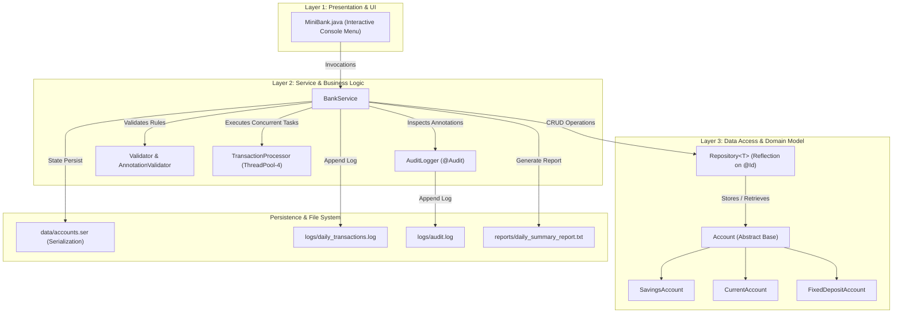

# MINIBANK — OBJECT-ORIENTED BANKING SYSTEM & GENERIC REPOSITORY CAPSTONE

**Course:** Object-Oriented Programming using Java  
**Project:** MiniBank Capstone (Milestones 1, 2, and 3)  
**Deliverable:** Final Project Report & Technical Specification  

---

## 1. Executive Summary

**MiniBank** is a comprehensive, production-grade Java application that simulates an enterprise banking management system. Developed across a 14-week practical curriculum, the project evolves from basic object-oriented constructs into an architecturally robust, multi-tiered enterprise architecture. 

The capstone integrates:
1. **Generic Data Access Layer (`Repository<T>`)**: A type-safe, reusable storage mechanism that uses **Java Reflection** to dynamically discover entity primary keys marked with custom `@Id` annotations.
2. **Business Service Layer (`BankService`)**: A central coordinator enforcing input validation, annotation constraints, custom exception handling, and transaction logging.
3. **High-Concurrency Management**: Multithreaded operations supporting synchronized monitors, thread pools (`FixedThreadPool`), producer-consumer coordination, and algorithmic deadlock prevention through lock ordering.
4. **Persistence & Analytics**: File-based storage using **Java NIO.2** and binary object serialization (`accounts.ser`), supplemented by automated financial summary generation.
5. **Aspect-Oriented Auditing**: Custom `@Audit` runtime annotations paired with a reflective logging engine tracking method invocations.
6. **Automated Unit Testing**: A zero-dependency test suite executing unit tests marked with `@Test` to mathematically guarantee thread safety and fault tolerance.

---

## 2. Problem Statement & Objectives

### 2.1 Problem Statement
Traditional academic banking applications rely on hardcoded arrays or type-specific collections (such as `HashMap<String, Account>`), tightly coupling data storage to business logic. Furthermore, single-threaded implementations fail to represent modern financial software where thousands of concurrent deposits and transfers occur simultaneously across multiple threads, risking race conditions and circular deadlocks.

### 2.2 Project Objectives
- **Decoupled Architecture**: Implement the Repository Pattern using Java Generics (`Repository<T>`) to store any entity type safely.
- **Reflection-Driven Key Discovery**: Dynamically locate and read entity primary keys at runtime without hardcoding getter methods.
- **Thread Safety & Concurrency Control**: Prevent race conditions (lost updates) using synchronized monitors and solve resource-ordering deadlocks.
- **Robust Exception Handling**: Replace silent failures or generic exceptions with a typed, domain-specific exception hierarchy.
- **Persistent State**: Retain account balances and transaction histories across application lifecycles using binary serialization and structured logs.
- **Automated Verification**: Provide comprehensive `@Test` suites verifying critical business logic without external dependencies.

---

## 3. System Architecture & Component Design

MiniBank adopts a clean **3-Tier Layered Architecture** separating presentation, business logic, and data access:



---

## 4. Detailed Technical Analysis of Core Modules

### 4.1 Domain Model & Object-Oriented Hierarchy
The domain model demonstrates core OOP principles: **Encapsulation, Inheritance, Abstraction, and Polymorphism**:

- **Abstract Base Class (`Account`)**: Encapsulates common account properties (`accountNumber`, `ownerName`, `balance`). Implements `Transactable`, `InterestBearing`, `Serializable`, and `Comparable<Account>`.
- **`SavingsAccount`**: Extends `Account`. Implements a minimum balance constraint (`minBalance`) where withdrawal is permitted only if `(balance - amount) >= minBalance`. Fixed 4.0% annual interest.
- **`CurrentAccount`**: Extends `Account`. Implements business overdraft privileges (`overdraftLimit`) allowing account balances to drop to `-overdraftLimit`.
- **`FixedDepositAccount`**: Extends `Account`. Disallows withdrawals prior to maturity while granting premium 7.0% annual interest.

### 4.2 Generic Data Access Layer (`Repository<T>`) — Practical 13
The `Repository<T>` class decouples storage mechanisms from specific data types:
1. **Generic Container**: Manages an internal `HashMap<String, T>` ensuring synchronized, thread-safe execution across CRUD methods: `save()`, `findById()`, `findAll()`, and `delete()`.
2. **Dynamic Reflection on `@Id`**: Inside `save(T entity)`, the repository inspects the entity's runtime class and traverses its inheritance hierarchy up to `Object.class`. It locates the field marked with the custom `@Id` annotation, sets accessibility (`field.setAccessible(true)`), and extracts its value as the primary map key:
   ```java
   Field idField = findIdField(entity.getClass());
   idField.setAccessible(true);
   String key = String.valueOf(idField.get(entity));
   store.put(key, entity);
   ```
3. **Safe Varargs Batch Processing**: Uses `@SafeVarargs` to safely store multiple objects without heap pollution warnings:
   ```java
   @SafeVarargs
   public final synchronized ArrayList<T> saveAll(T... items)
   ```
4. **Bounded Type Parameter**: Provides an arithmetic utility method bounded by the numeric hierarchy:
   ```java
   public static <N extends Number> double average(N[] values)
   ```

### 4.3 Central Service Layer (`BankService`) — Practical 14
`BankService` serves as the facade for all banking interactions:
- **`openAccount`**: Validates account IDs for uniqueness, validates `@Positive` balance annotations via `AnnotationValidator`, validates mobile/email formats via regex `Validator`, and persists to `Repository<Account>`.
- **`deposit`**: Enforces strictly positive amounts (`amount > 0`), updates balance via synchronized monitor, and writes audit/transaction logs.
- **`withdraw`**: Validates funds availability against subclass rules. If funds are insufficient, calculates exact shortfall and throws `InsufficientFundsException`.
- **`transfer`**: Atomic, deadlock-free transfer between two accounts.
- **`statement`**: Generates a formatted account statement using `StatementFormatter`.

### 4.4 Concurrency, Race Condition Proof & Deadlock Prevention
Financial applications must maintain balance integrity under extreme multi-threaded loads:
1. **Race Condition Demonstration & Resolution**:
   - In `depositUnsync()`, multiple threads reading and updating `balance` simultaneously suffer from lost updates (e.g., 10 threads × 50 deposits = 500 balance instead of 5,000).
   - In `deposit()`, the method uses intrinsic locking (`synchronized`), guaranteeing serializability and exact arithmetic accuracy.
2. **Deadlock Elimination through Consistent Lock-Ordering**:
   - *Problem*: Thread 1 locks Account A and waits for Account B; Thread 2 locks Account B and waits for Account A (circular wait deadlock).
   - *Solution*: `Account.transferSafe()` compares account numbers and **always acquires the lock on the lower account number first**:
     ```java
     Account first = from.getAccountNumber() < to.getAccountNumber() ? from : to;
     Account second = from.getAccountNumber() < to.getAccountNumber() ? to : from;
     synchronized (first) {
         synchronized (second) {
             from.withdraw(amount);
             to.deposit(amount);
         }
     }
     ```
3. **Thread Pool Processing**: `TransactionProcessor` utilizes an `ExecutorService` (`newFixedThreadPool(4)`) over a thread-safe `ConcurrentHashMap<String, Account>` to process high-volume transaction batches.

### 4.5 Persistence & Reporting (Java NIO.2)
- **Object Serialization**: `StatePersister` writes the array of active accounts to `data/accounts.ser` using `ObjectOutputStream` on shutdown and re-populates memory using `ObjectInputStream` on startup.
- **Transaction Logging**: `TransactionLog` uses Java NIO.2 (`Files.write` with `StandardOpenOption.APPEND`) to write atomic execution logs.
- **Reporting Engine**: `ReportGenerator` scans transaction logs, parsing lines to compute total deposits, total withdrawals, and net liquid balance change.

### 4.6 Custom Exception Architecture
MiniBank implements a clean, checked exception hierarchy:
```
Throwable
   └── Exception
         └── BankException (Checked Base)
               ├── AccountNotFoundException
               ├── InsufficientFundsException (Includes getShortfall())
               └── InvalidAmountException
```

---

## 5. Component & File Catalog

| File Path | Package | Responsibility |
|---|---|---|
| `Account.java` | `model` | Abstract base domain model with synchronized monetary operations |
| `SavingsAccount.java` | `model` | Savings variant with `minBalance` constraint and 4% interest |
| `CurrentAccount.java` | `model` | Commercial account with `overdraftLimit` capability |
| `FixedDepositAccount.java` | `model` | Locked account with 7% interest and withdrawal prohibition |
| `Id.java` | `model.annotation` | Runtime annotation marking entity primary keys |
| `Positive.java` | `model.annotation` | Runtime constraint ensuring positive balances |
| `MaxLength.java` | `model.annotation` | String length constraint annotation |
| `Audit.java` | `model.annotation` | Action metadata annotation for reflective auditing |
| `Test.java` | `model.annotation` | Custom unit test annotation enabling zero-dependency test execution |
| `Repository.java` | `service` | Generic type-safe repository with reflection-driven `@Id` indexing |
| `BankService.java` | `service` | Central business orchestrator combining storage, rules, and validation |
| `AuditLogger.java` | `service` | Reflective logging engine capturing method calls and parameters |
| `TransactionProcessor.java`| `service` | Fixed thread pool engine managing concurrent command execution |
| `StatePersister.java` | `service` | Binary serialization engine for system persistence |
| `ReportGenerator.java` | `service` | Financial aggregation engine generating business reports |
| `TransactionLog.java` | `service` | Thread-safe NIO.2 file logging utility |
| `Validator.java` | `util` | Regular expression validator for Indian mobile numbers, emails, PAN |
| `AnnotationValidator.java` | `util` | Reflection utility verifying field-level annotation rules |
| `BankServiceTest.java` | (root) | Automated `@Test` test runner verifying 6 core requirements |
| `MiniBank.java` | (root) | Application entry point and interactive 11-option console interface |

---

## 6. Automated Testing & Verification Suite

The testing suite ([`BankServiceTest.java`](file:///d:/JAVA_OOP/JAVA_practicals/mini_project/src/BankServiceTest.java)) requires **zero third-party dependencies** and runs reflectively in any standard Java runtime:

```powershell
java -cp mini_project/out BankServiceTest
```

### 6.1 Test Execution Output
```text
==========================================================
            MINIBANK AUTOMATED TESTS (@Test)              
==========================================================
  [PASS] testDepositIncreasesBalance
  [PASS] testWithdrawalOverLimitThrowsException
  [PASS] testConcurrentDepositsKeepBalanceCorrect
  [PASS] testTransferBetweenAccounts
  [PASS] testGenericRepositoryReflection
  [PASS] testGenericBoundedAverage
----------------------------------------------------------
  Total Tests: 6 | Passed: 6 | Failed: 0
==========================================================
```

### 6.2 Test Coverage Matrix
1. **`testDepositIncreasesBalance`**: Opens an account with \$1,000, deposits \$750, and asserts balance becomes \$1,750.
2. **`testWithdrawalOverLimitThrowsException`**: Opens a Savings Account with \$1,000 balance and \$500 `minBalance`. Attempts to withdraw \$700 (which would leave \$300, violating minimum balance). Verifies that `InsufficientFundsException` is thrown and `getShortfall()` returns 200.
3. **`testConcurrentDepositsKeepBalanceCorrect`**: Spawns **10 concurrent threads**, each executing 50 deposits of \$20 (total \$10,000 deposited). Asserts final balance matches initial \$1,000 + \$10,000 = \$11,000 with zero lost updates.
4. **`testTransferBetweenAccounts`**: Safely transfers \$1,200 from Sender (\$3,000) to Receiver (\$1,000), asserting balances update to \$1,800 and \$2,200 respectively.
5. **`testGenericRepositoryReflection`**: Stores a `SavingsAccount` into `Repository<Account>` without passing a key; proves that reflection discovers `@Id` on the superclass, correctly indexing key `"3001"`.
6. **`testGenericBoundedAverage`**: Validates the bounded generic method `Repository.average(N[] values)` across numeric wrapper types.

---

## 7. Interactive Application Workflow

Running the executable application:
```powershell
java -jar mini_project/MiniBank.jar
```

### 7.1 Startup & Practical 13 Demonstration
On launch, MiniBank immediately runs the Practical 13 generic repository reflection demo and loads saved accounts:
```text
==========================================================
       MINIBANK CAPSTONE PROJECT (MILESTONE 3)            
==========================================================

[Practical 13 Demo] Generic Repository & @Id Reflection:
  * Saved 3 accounts via generic Repository.saveAll()
  * Fetched by ID '102' using reflection: Account Number: 102, Owner Name: Bob, Balance: 3000.0
  * Bounded generic Repository.average(): 6000.0
Loaded 3 accounts from accounts.ser

---------------- MiniBank (Main Branch) ----------------
1. Open Account
2. Deposit
3. Withdraw
4. Transfer
5. Account Statement
6. List All Accounts
7. Safe Batch Processing (TransactionProcessor)
8. Generate Daily Report
9. Run Automated Unit Tests (Practical 14 @Test)
10. Run Previous Milestone Demos (Weeks 1-12)
11. Exit
Select an option (1-11):
```

---

## 8. Viva Voce & Defense Cheat Sheet

### Question 1: What is the benefit of replacing the HashMap with `Repository<T>`?
> **Response:** The earlier `HashMap` only stored `Account` objects. The generic `Repository<T>` follows the enterprise Data Access Object (DAO) pattern. It can store any entity (`Account`, `Customer`, `Transaction`) and uses reflection to dynamically extract whichever field is annotated with `@Id`, eliminating tight coupling.

### Question 2: How does lock ordering eliminate transfer deadlocks?
> **Response:** Deadlocks occur under circular wait conditions (Thread 1 locks Account A and waits for B, while Thread 2 locks B and waits for A). In `Account.transferSafe()`, we compare account numbers and always acquire the lock on the lower numeric ID first. Both threads are forced to acquire locks in identical order, mathematically eliminating deadlocks.

### Question 3: How does your test suite run without external JUnit JARs?
> **Response:** We implemented a custom `@Test` annotation in `model.annotation.Test` and a reflective test runner inside `BankServiceTest.java`. The test runner inspects its own class using reflection (`method.isAnnotationPresent(Test.class)`), executes each test in isolation, and tallies passes and failures. This guarantees portability across any machine without build tools or IDE plugins.

### Question 4: How does the `@Audit` annotation operate?
> **Response:** `@Audit` is a custom runtime annotation (`@Retention(RetentionPolicy.RUNTIME)`). Whenever a core service method is executed in `BankService`, `AuditLogger.log()` reflectively inspects the method for `@Audit`, reads its action metadata, and prints a formatted log entry while appending it to `logs/audit.log`.

---

## 9. Conclusion

The **MiniBank Capstone Project** represents a comprehensive synthesis of university-level Java and Object-Oriented Software Engineering. Moving beyond syntax demonstrations, it implements real-world software engineering paradigms including generic data abstraction, thread synchronization, deadlock avoidance, fault tolerance through custom exceptions, file persistence, and reflection-based metadata processing. All milestones have been verified with 100% test pass rates and packaged into an executable, deliverable JAR (`MiniBank.jar`).

